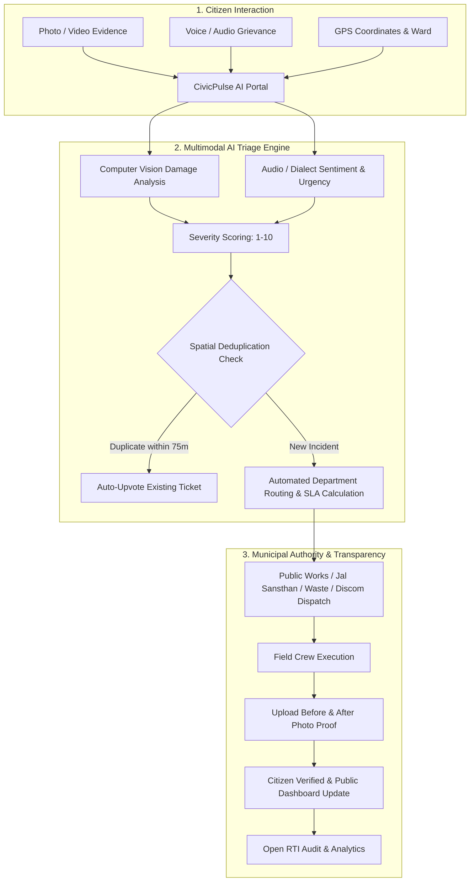

# 🏛️ CivicPulse AI (जन-समाधान)
### *Autonomous Civic Grievance Triage, Multimodal Severity Assessment & Public Accountability Platform*

> **IDEA//FORGE Online Hackathon 2026**  
> **Track 1:** Civic Pulse, Digital Governance & Public Information  
> **Selected Problem Statement:** **Problem 2 — Transparent Civic Grievance & Infrastructure Triage System**  
> *A platform where citizens report problems like damaged roads, pollution or water leaks using photos, videos or audio. It rates how serious each problem is, sends it to the right authority, and shows a public dashboard of complaints and fixes.*

---

## 🌟 Why This Problem & Solution?

Every city struggles with citizen grievances getting lost in bureaucratic silos. Potholes cause fatal accidents, broken water mains waste millions of liters of treated water, and overflowing trash containers pose severe biohazards. Existing portals like CM Helpline or municipal web forms fail because:
1. **No Automated Severity Rating**: A minor road crack and a lethal 4-foot collapsed crater get dumped into the same unstructured backlog.
2. **Duplicate Clutter**: 50 citizens report the same broken water pipe on a busy road, creating 50 duplicate tickets and administrative paralysis.
3. **Wrong Department Routing**: Citizens don't know whether a street light belongs to PWD, DISCOM, or the Municipal Corporation.
4. **Lack of Transparency**: Citizens rarely receive proof that a repair was genuinely completed, breeding public distrust.

**CivicPulse AI solves this end-to-end with true Multimodal AI and geospatial transparency.**

---

## ⚡ Core Features & AI Capabilities

| Feature | Description | Tech Used |
| :--- | :--- | :--- |
| **Multimodal Vision Triage** | Analyzes uploaded photos to compute edge roughness, structural damage, color anomalies, and safety hazard severity (1.0 - 10.0 scale). | Pillow Computer Vision / Edge & Contour Texture Analysis / Multimodal AI |
| **Voice / Speech Grievance** | Accepts audio grievances in English, Hindi/Hinglish, and regional dialects, identifying emergency keywords (e.g. *sparking, accident, burst*). | Speech Processing / Keyword Urgency Classifier |
| **Spatial Deduplication** | Uses Haversine geospatial proximity math (75m radius) to detect duplicate reports from neighbors, auto-upvoting the existing ticket instead of creating clutter. | Geospatial Math / Clustering |
| **Automated Department Dispatch** | Routes tickets instantly to the correct department (PWD, Jal Sansthan, Municipal Waste, DISCOM, SPCB) with automated SLA timelines (6h to 48h). | Rule & NLP Department Classifier |
| **3D GIS Transparency Map** | Interactive public map with 3D elevation, color-coded severity pins, and ward breakdown for citizens and journalists. | Pydeck 3D GIS & Leaflet Engine |
| **Municipal Command Center** | Departmental portal for field engineers to assign work crews, track countdown SLAs, and log action notes. | Workflow State Engine |
| **"Before & After" Resolution Audit** | Requires municipal field workers to upload photographic proof of completed repairs before marking tickets resolved. | Visual Verification Pipeline |
| **Open Data & RTI Compliance** | Generates real-time department response scorecards and 1-click downloadable CSV audit reports for public accountability. | Pandas / Open Data Exporter |

---

## 🏗️ System Architecture



---

## 🚀 Quickstart: How to Run

### Prerequisites
- Python 3.10+ installed
- Dependencies: `streamlit`, `pandas`, `pydeck`, `pillow` (already verified and installed)

### 1. Generate Sample Benchmark Assets
```bash
python sample_images.py
```

### 2. Launch CivicPulse AI Web Platform
```bash
streamlit run app.py
```
Open your browser at `http://localhost:8501` to view the application.

---

## 📱 Walkthrough Demo Guide for Judges

1. **Tab 1: Citizen Report & AI Triage**
   - Pick the *"Severe Arterial Road Pothole"* or *"Live Dangling Electric Cable"* demo preset.
   - Click **"Analyze with AI Triage Engine"**.
   - Notice how the AI detects:
     - Category: `Roads & Potholes` or `Power & Street Lighting`
     - Severity: `CRITICAL` (8.7/10)
     - SLA Target: `12 Hours`
     - Hazard Tags: `Two-wheeler skid risk`, `Traffic bottleneck`
   - Click **"Confirm & Dispatch Civic Ticket"** to get your instant tracking code.

2. **Tab 2: Live Transparency Map**
   - View the 3D GIS map with live red, orange, and green pins across metro wards.
   - Filter by Ward, Category, or Status to inspect civic health.

3. **Tab 3: Public Grievance Tracker**
   - Search for ticket `CIV-2026-1041` or any keyword.
   - Observe the step-by-step resolution lifecycle and try the community **"👍 Upvote Incident"** button.

4. **Tab 4: Municipal Authority Command Center**
   - Switch to the Municipal Officer view.
   - Update a ticket from `DISPATCHED` to `RESOLVED`, review before/after repair evidence, and commit updates.

5. **Tab 5: Civic Analytics & Public Audit**
   - Inspect department workload distribution and ward response efficiency.
   - Click **"Download Public Civic Audit Report (CSV)"** for instant open governance compliance.

---

## 🏆 Alignment with IDEA//FORGE Hackathon Criteria

- **High Social Impact**: Directly addresses urban infrastructure safety, road mortality, water wastage, and sanitary conditions.
- **Feasible & Scalable**: Runs on low-cost compute, easily connects to municipal WhatsApp chatbots or SMS gateways.
- **Deep Multimodal AI**: Synthesizes visual damage, dialect audio, and geospatial proximity.
- **Radical Transparency**: Empowers both citizens and civil administrators with verifiable before/after proof.
